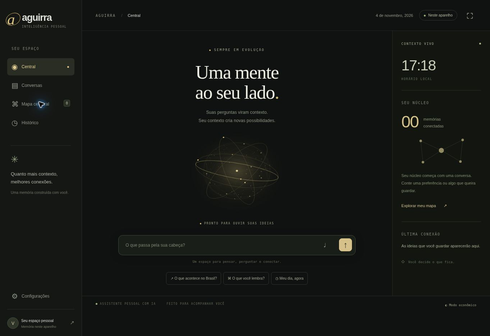

<div align="center">


# Aguirra

**Uma mente ao seu lado.**

Assistente pessoal web com conversas, pesquisa e um núcleo de memória que você pode entender, editar e esquecer.

`Ollama local` · `TypeScript` · `SQLite` · `Supabase Free` · `JavaScript ES5`

</div>

---



## O que já existe

- Central com núcleo visual em Canvas 2D, relógio e contexto da memória.
- Conversas e histórico pesquisável.
- Mapa cerebral interativo, com categorias e memórias reais; sem dados pessoais de exemplo pré-carregados.
- Formação conservadora de memórias por declarações explícitas: `Prefiro respostas curtas`, `Meu nome é…`, `Meu objetivo é…`, `Lembre que…`.
- Criação, edição, exclusão, importação de memórias locais e exportação JSON dos dados carregados.
- Conta e sincronização na nuvem pelo Supabase, com isolamento por usuário.
- IA local no computador com Ollama; nenhum endpoint de modelo pago.
- Manchetes por feeds RSS públicos gratuitos e ferramenta de data/hora.
- Interface leve, modo econômico e melhorias opcionais de voz e tela cheia.

**Sem login**, a memória e o histórico funcionam neste navegador. As respostas locais são limitadas a memória, data/hora e orientações de uso. A conversa completa roda no computador com Ollama, acessada pelo endereço local; não há respostas fictícias de demonstração.

## Memória, de verdade

Todo pedido é histórico. Uma declaração útil pode virar núcleo. Uma pergunta sobre um assunto aumenta sua frequência, mas não vira uma crença ou preferência sua.

O Aguirra recupera contexto para responder melhor. Isso **não retreina os pesos do modelo**. Alguns padrões de credenciais e dados sensíveis são bloqueados na extração; isso não é um detector universal de dados pessoais.

Veja o [mapa da arquitetura, fluxo da memória e decisões técnicas](docs/architecture.md).

## Rodar sem API paga

No Windows, instale **Node.js 24.x** e **Ollama**, baixe este repositório e abra **Iniciar-Aguirra.cmd**.

O terminal mostra o código de acesso e o endereço para abrir no tablet, na mesma rede do computador.

```bash
npm ci
ollama pull qwen3:4b
ollama create aguirra-local -f Modelfile
npm run local
```

**O PC precisa ficar ligado.** O tablet apresenta a interface; o modelo e o SQLite ficam no computador. Nenhuma chave de IA ou cartão é necessário. O download inicial do modelo tem aproximadamente 2,5 GB.

O [guia sem custo](docs/sem-custo.md) explica instalação, rede, código de acesso e limites. Os endpoints externos e modelos cloud estão bloqueados. Não há fallback para uma API paga.

### Hospedagem online opcional

A versão online oferece interface, memória, histórico e manchetes RSS. A sincronização usa o Supabase Free e a hospedagem Vercel Hobby, respeitando suas cotas. A geração de IA fica desativada na hospedagem. O aplicativo não faz upgrade automático de planos.

Para reproduzir a sincronização, use um projeto Supabase dedicado e aplique [database/schema.sql](database/schema.sql). A aplicação usa apenas a chave publicável e o token do usuário, preservando RLS; não utiliza chave administrativa. Configure o Site URL de Auth para a origem publicada.

### Verificar

```bash
npm run typecheck
npm test
npm run build
```

O build produz o servidor local fora da Vercel. Na Vercel, produz o Build Output. Não force VERCEL=1 sem um projeto vinculado e as credenciais de implantação.

## Android 4.4

O frontend usa JavaScript ES5, XMLHttpRequest, SVG e Canvas 2D. O modo econômico é recomendado e ativado inicialmente no Android 4.x. Angular moderno, WebGL e SDKs recentes não são dependências do tablet.

**É necessário testar no tablet real.** Navegador, certificados HTTPS/TLS e desempenho podem impedir recursos mesmo com código compatível. Voz e tela cheia são opcionais; digitação permanece disponível.

## Verificação

- `npm test`: extração, bloqueio de credenciais/hipóteses, recuperação, paridade entre cliente e servidor, cookies e origem de pedidos.
- [tests/rls.sql](tests/rls.sql): isolamento de usuários, escrita cruzada, vínculo da conversa, cota atômica e exclusão. Fixtures transacionais são revertidas.
- Testes de código de acesso, SQLite, RSS e bloqueio de modelos externos.
- Protocolo do adaptador Ollama verificado com servidor local de teste; nenhuma API paga.
- Sintaxe ES5 verificada automaticamente e persistência inspecionada no navegador.

Limitações atuais, incluindo paginação e consolidação de preferências conflitantes: [arquitetura](docs/architecture.md).

---

Feito por **Matheus Aguirra**.
