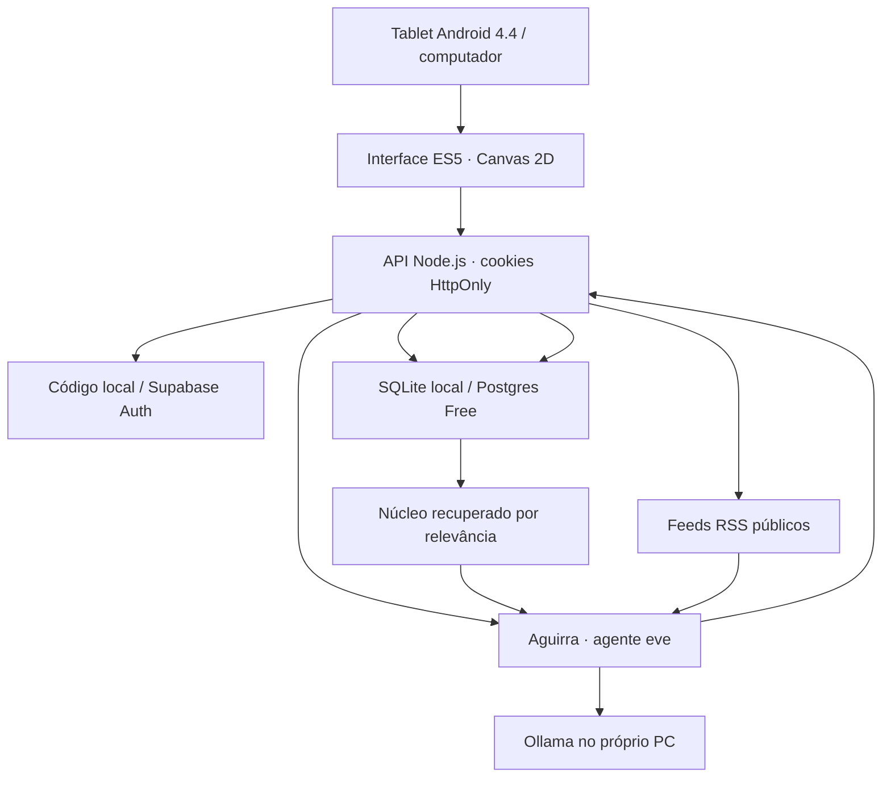

# Arquitetura do Aguirra

O tablet apresenta a interface. IA, pesquisa e autenticação ficam no servidor. O núcleo é memória recuperada a cada pedido; não é retreinamento do modelo.

## Dados

| Coleção | Conteúdo |
| --- | --- |
| `aguirra_threads` | Conversas e títulos |
| `aguirra_messages` | Pedidos, respostas, fontes e exclusão do contexto |
| `aguirra_memories` | Preferências, perfil, objetivos, projetos e notas |
| `aguirra_topics` | Contagem de assuntos; não declara preferências |
| `aguirra_settings` | Formação de novas memórias |
| `aguirra_private.rate_limits` | Controle atômico de consultas |

Cada memória tem conteúdo, categoria, origem, data e, quando disponível, a mensagem de origem. Nome é atualizado pela mesma chave; declarações idênticas são deduplicadas. Preferências conflitantes devem ser revistas no mapa: ainda não há consolidação semântica automática.

## Um pedido

1. Autenticar no Supabase. Validar origem, tamanho e campos.
2. Verificar repetição do identificador e consumir a cota atômica.
3. Salvar pedido e assuntos; extrair declarações explícitas se habilitado.
4. Recuperar preferências gerais e memórias relevantes por palavras. O núcleo pequeno não exige embeddings pagos.
5. Para respostas, chamar o adaptador fixado: Google com pesquisa e cota global se habilitado, ou Ollama local. Enviar o núcleo atualizado e até seis mensagens recentes. Não reutilizar sessões de geração entre pedidos.
6. Data/hora, registro de memórias e manchetes RSS são resolvidos sem chamar modelo. O modelo local pode consultar RSS; não há pesquisa paga, shell ou ações externas.
7. Persistir resposta e fontes disponíveis nos resultados. Visitantes guardam a resposta no navegador; contas salvam com a própria sessão Supabase e RLS.

Se a IA falhar, o pedido e as memórias já salvos permanecem no histórico. O erro é informado sem simular geração real.

## Esquecer e corrigir

Ao editar ou esquecer uma memória automática, sua mensagem de origem deixa de ser enviada como contexto, mas continua visível no histórico. Sessões de IA não são reutilizadas entre pedidos. Apagar todos os dados é uma transação restrita ao dono.

Essa exclusão diz respeito aos registros do aplicativo. Retenção de logs e dados no provedor depende dos termos e controles do serviço.

## Compatibilidade

- JavaScript ES5 e XMLHttpRequest. Sem módulos JS, WebGL, CSS Grid, fontes externas ou SDK moderno de autenticação no tablet.
- Canvas 2D com poucos elementos. Modo econômico congela efeitos e inicia ativo em Android 4.x.
- Voz e tela cheia são melhorias detectadas no navegador. Não há escuta permanente ou promessa de PWA no Android 4.4.
- Sintaxe compatível não garante HTTPS: navegador, TLS, certificados e desempenho precisam de testes no hardware real.

## Implantação e acesso

O modo principal é local: Node 24, eve, Ollama em loopback e SQLite no computador. O tablet acessa a interface por HTTP na mesma rede privada. O SQLite mantém um documento transacional com conversas, núcleo, assuntos, cotas e hashes das sessões. O código local é armazenado com scrypt; tokens de sessão são aleatórios e persistidos como hashes. Escritas validam Origin.

Na hospedagem online, o Google só é chamado com chave e confirmação explícita de projeto sem faturamento. Sem essa configuração, não se inicia geração remota. A interface e a sincronização opcional usam Vercel Hobby e Supabase Free. O servidor consulta o Supabase com o token do próprio usuário e preserva RLS. Não utiliza service_role. Cookies são HttpOnly e Secure em HTTPS. O sandbox virtual não cria VM; nenhuma ferramenta de shell é disponibilizada.

Não há fallback para AI Gateway ou modelos pagos. O adaptador Ollama aceita somente HTTP em localhost. O adaptador opcional Google fixa gemini-2.5-flash-lite e exige adesão ao projeto gratuito, cota atômica e fontes na resposta. As notícias vêm de feeds públicos com URLs fixas; não são uma busca geral da web.

## Limites atuais

- 30 pedidos/hora e 100/dia por acesso. É um controle de uso, não contratação de capacidade.
- UI carrega até 100 conversas, 500 memórias e 1.000 mensagens recentes. A exportação corresponde aos dados carregados. Paginação completa é evolução prevista.
- Extração automática por declarações explícitas. Não há embeddings ou associação automática de perguntas com preferências.
- Preferências conflitantes ainda são revisadas no mapa; não há consolidação semântica automática.
- O modo local exige PC ligado e tablet na mesma rede. Fora dela, a conversa com Ollama não fica disponível automaticamente.
- Voz, TLS, rolagem e desempenho no Android 4.4 precisam de teste no aparelho real.

Veja [o guia sem custo](sem-custo.md).

## Acesso público e Google

POST /api/chat aceita visitantes antes da barreira de autenticação das rotas de dados. O visitante envia contexto limitado e não recebe uma identidade de nuvem. O servidor não persiste suas perguntas nas tabelas de contas. O cliente salva o histórico e o núcleo no navegador. Rotas de sincronização continuam exigindo conta; as políticas RLS não foram abertas para anon.

A função pública de cota recebe um token exclusivamente do servidor, valida seu hash em tabela privada e só retorna um booleano. Há 30 pedidos/hora por rede e 100 tentativas Google/dia globais. Nenhuma tabela privada fica acessível a anon ou authenticated. A migração adiciona somente a coluna de sugestões do Google às mensagens e os objetos privados de limite.

Veja [ativação e limites do Google gratuito](google-gratuito.md). A chave do Google está pendente; a integração foi verificada com respostas simuladas e falhas de cota, sem chamar um serviço pago.
