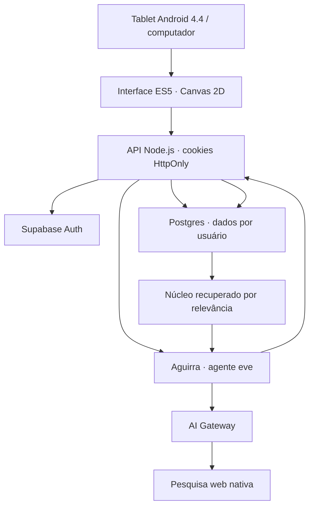

# Arquitetura do Aguirra

O tablet apresenta a interface. IA, pesquisa e autenticação ficam no servidor. O núcleo é memória recuperada a cada pedido; não é retreinamento do modelo.

## Dados

| Coleção | Conteúdo |
| --- | --- |
| `aguirra_threads` | Conversas e títulos |
| `aguirra_messages` | Pedidos, respostas, fontes e exclusão do contexto |
| `aguirra_memories` | Preferências, perfil, objetivos, projetos e notas |
| `aguirra_topics` | Contagem de assuntos; não declara preferências |
| `aguirra_settings` | Formação de novas memórias |
| `aguirra_private.rate_limits` | Controle atômico de consultas |

Cada memória tem conteúdo, categoria, origem, data e, quando disponível, a mensagem de origem. Nome é atualizado pela mesma chave; declarações idênticas são deduplicadas. Preferências conflitantes devem ser revistas no mapa: ainda não há consolidação semântica automática.

## Um pedido

1. Autenticar no Supabase. Validar origem, tamanho e campos.
2. Verificar repetição do identificador e consumir a cota atômica.
3. Salvar pedido e assuntos; extrair declarações explícitas se habilitado.
4. Recuperar preferências gerais e memórias relevantes por palavras. O núcleo pequeno não exige embeddings pagos.
5. Abrir sessão curta de eve com núcleo atualizado e até dez mensagens recentes da conversa.
6. Consultar hora ou pesquisar na web quando necessário. Shell, arquivos e ações externas não são ferramentas disponíveis.
7. Persistir resposta e fontes disponíveis nos resultados. Encerrar a sessão. Workflow solicita retenção zero ao término.

Se a IA falhar, o pedido e as memórias já salvos permanecem no histórico. O erro é informado sem simular geração real.

## Esquecer e corrigir

Ao editar ou esquecer uma memória automática, sua mensagem de origem deixa de ser enviada como contexto, mas continua visível no histórico. Sessões de IA não são reutilizadas entre pedidos. Apagar todos os dados é uma transação restrita ao dono.

Essa exclusão diz respeito aos registros do aplicativo. Retenção de logs e dados no provedor depende dos termos e controles do serviço.

## Compatibilidade

- JavaScript ES5 e XMLHttpRequest. Sem módulos JS, WebGL, CSS Grid, fontes externas ou SDK moderno de autenticação no tablet.
- Canvas 2D com poucos elementos. Modo econômico congela efeitos e inicia ativo em Android 4.x.
- Voz e tela cheia são melhorias detectadas no navegador. Não há escuta permanente ou promessa de PWA no Android 4.4.
- Sintaxe compatível não garante HTTPS: navegador, TLS, certificados e desempenho precisam de testes no hardware real.

## Implantação e acesso

Vercel executa Node 24 e Workflow. Supabase Auth/Postgres são um projeto dedicado. Gateway usa OIDC na Vercel. O sandbox virtual just-bash não cria VM; ferramentas de shell não são disponibilizadas.

O servidor verifica a sessão no Supabase e acessa o PostgREST com o token do próprio usuário, preservando RLS. Não usa service_role. Cookies são HttpOnly e Secure em HTTPS; escritas validam Origin para navegadores antigos sem SameSite.

## Limites atuais

- 30 pedidos/hora e 100/dia por usuário. Limite de sessão do modelo é aproximado, não teto de faturamento. Pesquisa e infraestrutura têm custos próprios.
- UI carrega até 100 conversas, 500 memórias e 1.000 mensagens recentes. A exportação corresponde aos dados carregados. Paginação e exportações maiores são evolução prevista.
- Extração automática por declarações explícitas. Não há extração semântica geral, embeddings ou associação livre de perguntas com preferências.
- Login exige criar conta e confirmar e-mail conforme o Supabase. Configurar Site URL para produção melhora o retorno dos links.
- Checklist no tablet: HTTPS, digitação, rolagem, recarregamento, login, voz, modo econômico e permanência em exibição.
