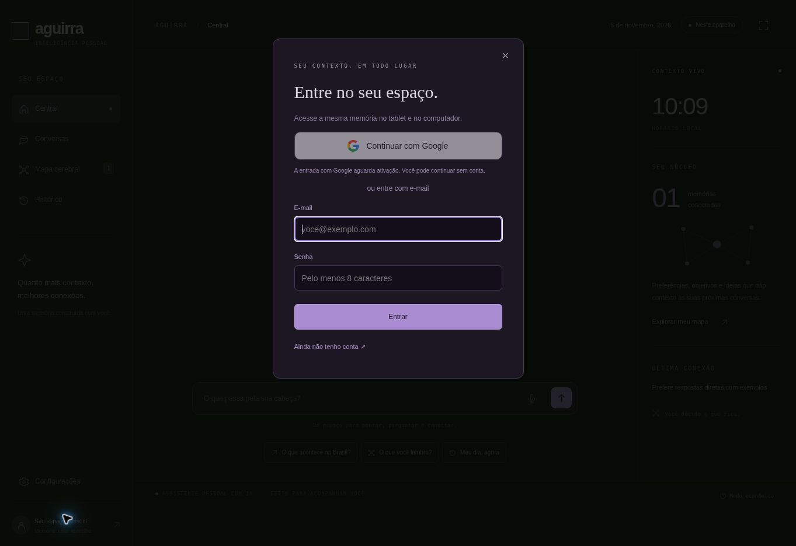

# Relatório de adaptação do Aguirra

Data: 05/11/2026 · Aplicação: https://aguirra-ai.vercel.app/

## Problema encontrado

A chave do proprietário foi cadastrada corretamente. O teste real retornou HTTP 404 porque o Google restringiu Gemini 2.5 Flash-Lite a projetos que já utilizavam o modelo. Criar outra chave não resolveria essa restrição. Nenhum faturamento foi ativado para contornar o bloqueio.

## Alterações realizadas

| Área | Resultado |
| --- | --- |
| Modelo | Substituição por Gemini 3.5 Flash-Lite, fixado no código, com geração de texto no Free Tier. |
| Recursos pagos | Removida a chamada a Google Search grounding. Não há troca automática para modelos pagos, URL context ou ferramentas pagas. Em indisponibilidade temporária do 3.5, há uma única alternativa de texto também gratuita: Gemini 3.1 Flash-Lite. Erros de cota, permissão e chave não acionam essa alternativa. |
| Acesso | Perguntas continuam sem conta; o núcleo e o histórico do visitante ficam no navegador. A sincronização de contas mantém autenticação e RLS. |
| Conhecimento | Consultas enciclopédicas explícitas usam a API pública da Wikipedia. São até três introduções limitadas, com URLs HTTPS do domínio permitido. |
| Coerência | Instruções como “responda em poucas frases” deixam de contaminar a busca. Fontes sem relação com o título do assunto são descartadas; o modelo é instruído a explicar primeiro o conceito pedido. |
| Notícias | Feeds BBC filtrados por assunto e país. A IA pode resumir os títulos e descrições consultados; se falhar, as manchetes continuam disponíveis. Não se alega leitura integral das matérias. |
| Transparência | Respostas sem documentos consultados exibem “Resposta da IA, sem pesquisa verificada na web”. Fontes são selecionadas por identificadores de documentos existentes. |
| Atualidade | Perguntas sobre preços, clima e outros fatos atuais sem fonte recebem uma limitação explícita. Não se inventa uma cotação ou resultado atual. |
| Voz e interface | Preservados o tema roxo, a marca quadrada vazia, os ícones e a leitura sintética compatível com o navegador ou Windows local. |

## Configuração e custo

A chave continua armazenada como segredo na Vercel e não foi incluída no código nem no relatório. A nova variável AGUIRRA_GOOGLE_FREE_CHAT=confirmed-no-billing libera exclusivamente a geração de texto. A variável antiga da integração incompatível permanece desativada.

O Google apresentou HTTP 503 por alta demanda durante a validação. Isso motivou a alternativa gratuita e não resultou em ativação de faturamento. Os dois modelos podem ficar temporariamente indisponíveis; não há garantia de serviço gratuito contínuo.

O limite global é de 100 tentativas de geração/dia para o projeto inteiro. Visitantes têm até 30 pedidos ao servidor/hora por identificador protegido de rede. Há limite de tokens e tempo; a aplicação não repete automaticamente a chamada no mesmo modelo. A alternativa gratuita, quando aplicável, também consome a cota global. As cotas do Google podem ser menores.

A proteção principal contra cobrança é manter o projeto Google sem conta de faturamento. O aplicativo não consegue verificar essa configuração apenas pela chave. Os planos Vercel Hobby e Supabase Free também têm suas próprias cotas. Nenhum plano ou recurso pago foi contratado nesta adaptação.

## Verificação

- 24 testes automatizados passaram: seleção de fontes, rejeição de referências inexistentes, ausência de ferramentas pagas, bloqueio de chamadas sem adesão explícita ao Free Tier, falha de cota sem repetição, memória, isolamento, voz e classificação de perguntas.
- TypeScript passou na verificação de tipos.
- Os três scripts do navegador passaram na checagem de sintaxe ES5.
- A consulta pública de conhecimento sobre RAM retornou o artigo “Memória de acesso aleatório”, após a correção da relevância.
- O primeiro teste real do modelo novo retornou HTTP 200 sem autenticação. A verificação revelou um desvio de assunto, corrigido antes da entrega.
- Verificação final de geração em produção: HTTP 200, sem conta, com explicação de RAM e duas fontes reais: “Memória de acesso aleatório” e “Memória do computador”. O retorno diferencia consulta a fontes de resposta não verificada.

## Limites que permanecem

O Aguirra não pesquisa o Google inteiro: a API Google Search não está incluída no Free Tier do modelo atual. Wikipedia e RSS são fontes limitadas e podem falhar; a IA também pode errar mesmo com fontes. Não há promessa de responder com fatos atuais fora das fontes disponíveis. Compatibilidade de voz, certificados HTTPS e desempenho no Android 4.4 ainda dependem de teste no tablet físico.

A memória é recuperação de contexto, não treinamento dos pesos do modelo. O modo local com Ollama permanece disponível como alternativa no computador.

## Referências

- Preços oficiais: https://ai.google.dev/gemini-api/docs/pricing#gemini-3.5-flash-lite
- Restrição dos modelos antigos: https://ai.google.dev/gemini-api/docs/deprecations
- Configuração atual: [google-gratuito.md](google-gratuito.md)

## Entrada com Google

Foi adicionado Continuar com Google ao modal de acesso. O fluxo usa Supabase Auth e PKCE S256 no servidor, com verificador e sessão em cookies HttpOnly e Secure. Não é exigida conta para fazer perguntas. Os testes cobrem a troca de código, cookie, origem e callback sem verificador.

**Pendente externo:** o provedor Google está desativado no Supabase e não possui credenciais OAuth fornecidas. O botão mostra esse estado, sem simular login funcional. A chave do Gemini não substitui o Client ID e Client Secret do OAuth. O [guia de ativação](login-google.md) lista os valores exatos a cadastrar no Google e Supabase. Não foi concluído um login real com Google.

